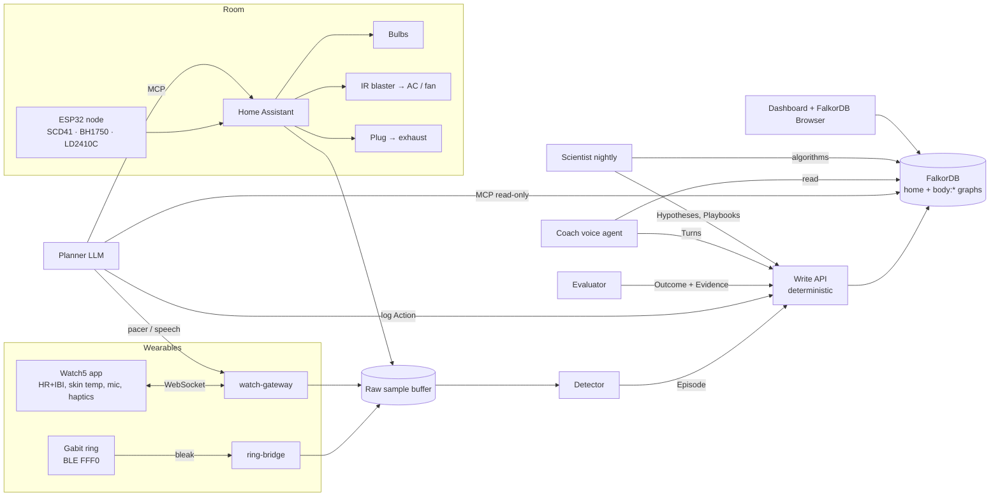

# Vagus: Project Context (Graph Hacks 2026)

> Working name. Last updated 2026-10-09.
> This file is the single source of truth for the team and for any coding assistant working on the repo.
> Facts marked **(verified)** were checked against a primary source. Facts marked **(verify)** are unconfirmed; test them before relying on them.

---

## 1. The project in three lines

- **Problem:** Wearables know when your body is stressed, overheated or sleeping badly, but the home runs fixed rules (or Samsung-only sleep → AC). Nothing learns which home action actually helps *your* body, and nothing explains why it acted.
- **Target:** Graph Hacks **Track 1 (Agents That Act on Connected Data)** and **Track 2 (Agent Memory and Coordination)**, entered together, with Track 1 leading the pitch. Users are people with a wearable and a smart home, including shared homes where each person's health data stays private.
- **Idea:** A home with a nervous system. The Gabit ring, Galaxy Watch5 and room sensors detect when your body drifts from its baseline. An agent picks the action that worked best for you in similar situations (lights, AC/fan, exhaust, a breathing pacer on the watch), measures how your body responded, and writes that back to FalkorDB. The resulting evidence graph is both the agent's memory and its decision policy, and the watch can answer "why did you do that?" with a chain of reasons from the graph.

---

## 2. The hackathon

| | |
|---|---|
| Name | **Graph Hacks: Context for AI Agents** (WeMakeDevs × FalkorDB) |
| Dates | Oct 15, 12:01 AM IST → **Oct 18, 11:59 PM IST**, 2026, online |
| Team | Solo or up to 4 |
| Prizes | Track 1: iPhone 18 Pro · Track 2: PS5 + GTA VI · Track 3: M6 Mac Mini · Best blog post: AirPods 5 · Top 50: T-shirts |
| Links | [Event](https://www.wemakedevs.org/hackathons/falkordb) · [Rules](https://www.wemakedevs.org/hackathons/falkordb/rules) · [Schedule](https://www.wemakedevs.org/hackathons/falkordb/schedule) · [Resources](https://www.wemakedevs.org/hackathons/falkordb/resources) · [FalkorDB Discord](https://discord.com/invite/Y2mMT9VdMy) |

**Track 1, Agents That Act on Connected Data:** multi-hop reasoning; graph queries and algorithms as agent tools; tool selection through MCP; actions based on graph data; explainable results.

**Track 2, Agent Memory and Coordination:** episodic, semantic and procedural memory; persistent conversation history; shared state between agents; concurrent access patterns; isolated memory per user or tenant.

### Rules that matter (verified)
- "FalkorDB must be the primary graph database, and it must support a central part of the product."
- "The graph has to do real work … if the product still works once FalkorDB is taken out, the graph is decoration."
- "You may reuse general libraries, templates, and infrastructure. The submission and its main FalkorDB implementation must be new work completed during the event."
- Multiple tracks: "You can enter one, two or all three, and each track has its own prize." You must name every track you are entering when you submit.
- Submit: repository, README, demo video, deployment and project info. "A live deployment is preferred." Projects that can't be deployed need full local setup instructions plus a working demo video.
- You must be able to explain your own graph model and queries.

### Unknowns (ask on Discord)
- Can one project win **both** Track 1 and Track 2 prizes? Not stated.
- We've been told judging uses an **AI evaluation pipeline per track**. This is not on the public pages. Find out what it reads (repo? README? video transcript? live deployment?).
- Is there a demo-video length limit? Not stated.

---

## 3. Strategy: tracks and AI judging

**Decision: enter Track 1 + Track 2. Skip Track 3.**
- If each track is scored independently, one project gets two chances. Nothing published penalises entering several tracks.
- Track 3 (Company Brain) doesn't fit. It would add a low score and make the project look unfocused.
- If we can only pick one, pick Track 1. Its example ideas are fraud, security and codebases, so a physical-world agent stands out. Track 2 already has public competitors building software-only memory layers ([howdycarter/graph-hacks-falkordb-2026](https://github.com/howdycarter/graph-hacks-falkordb-2026), [renigat7-cpu/graph-hacks-2026](https://github.com/renigat7-cpu/graph-hacks-2026)).

**Writing for an AI judge.** It mostly sees the repo, README and video, not the hardware, so every claim must be checkable:
1. Put a **Tracks section** at the top of the README with one table per track: official bullet → feature → file path → Cypher query → video timestamp. Use the tracks' own wording.
2. Include an **ablation**: run with FalkorDB disabled and show the agent can't decide, explain or coordinate.
3. Provide a **replay mode**: recorded real data, started with one `docker compose up`, runnable without any hardware.
4. Turn **Track 2 behaviours into tests** with output pasted in the README: lease race, restart-and-recall, cross-person isolation.
5. Add **video chapters per track**.
6. Keep it **one system seen two ways**. Don't bolt on separate features just to tick boxes.

---

## 4. What already exists, and the gap

| Existing | What it does | Why it isn't us |
|---|---|---|
| Samsung SmartThings + Watch/Ring ([article](https://phandroid.com/2026/05/27/your-galaxy-watch-can-now-tell-your-ac-when-youve-fallen-asleep/)) | Sleep detected → routines; 2026 Bespoke WindFree AC "Good Sleep" | Samsung devices only; no per-person learning or explanations disclosed |
| [glebis/polar-h10-ribbon](https://github.com/glebis/polar-h10-ribbon) | Live HRV → Hue lights, breathing pacer | Fixed mapping, no learning |
| [vickers-rz/HomeMind](https://github.com/vickers-rz/HomeMind) | LLM on Home Assistant suggests actions from "past similar events" | Learns from your manual choices, not your physiology |
| Auto-Care ([arXiv 2411.19000](https://arxiv.org/abs/2411.19000)), HiMe ([2607.21019](https://arxiv.org/abs/2607.21019)), [Google Personal Health Agent](https://research.google/blog/the-anatomy-of-a-personal-health-agent/) | Wearable LLM agents | Insights or one-off actions; nothing learns which home action works for you |
| SHACR ([arXiv 2606.22312](https://arxiv.org/abs/2606.22312)) | Neo4j + Claude smart-home conflict resolution | No body signals |
| [Smart Home Orchestrator](https://github.com/RenTechAU/hackathon-orbitalcommandcenter) (FalkorDB event, Aug 2026) | Occupant fairness ("who gave way last") | Don't copy the fairness angle |

**The gap we fill:** measure how *your body* responded to each home action, and store that as reusable, explainable knowledge that drives the next action.

### Lessons from past FalkorDB / graph hackathon winners
- **Make the graph's shape the insight.** [Atrium](https://github.com/nathansso/Atrium), 1st overall at [Memory Meets Motion](https://www.falkordb.com/blog/memory-meets-motion-the-falkordb-standouts/), modelled each misconception as its own node. Ours: evidence nodes as the policy.
- **Show numbers.** [Hopper](https://github.com/vraj00222/hopper) walked a 7-hop chain in under 100 ms.
- **Keep the agent's database access safe.** Read-only queries with timeouts and caps ([Board of SuperVision](https://github.com/LabGuy94/boardofsupervision)); the LLM never touches database credentials ([LOCAL GACHA](https://github.com/RTARO-LAB/local-gacha)); deterministic code does the writes (VeriGraph, [HackwithBay 3.0](https://medium.com/neo4j/graph-used-right-built-fast-neo4j-at-hackwithbay-3-0-0f49d933cabb)).
- **Hardware demos need a replay or simulated stream.** Smart Home Orchestrator used one.

### Ideas we considered and parked
ProbeGraph (circuit-board fault finding), HiveMind (shared robot memory), DoseGuard (pillbox), lockout/tagout planner, NetSentry (IoT network triage). We chose Vagus because it uses the hardware we already own.

---

## 5. The product

### The loop
1. **Sense.** Ring, watch and room sensors stream into a raw buffer.
2. **Detect.** Deterministic code opens an `Episode` when your signals leave *your* baseline (post-workout HR, falling HRV at night, restless sleep).
3. **Decide.** The planner asks FalkorDB which intervention moved your body most in situations like this one.
4. **Act.** Lights, AC/fan (via IR), exhaust fan (via plug), or a breathing pacer on the watch at your learned rate.
5. **Measure.** The evaluator computes the outcome on your body and writes it back.
6. **Learn and explain.** Evidence updates, so next time is better. Any decision can be explained as a graph path with numbers.

### The standout element: n-of-1 micro-experiments
With the user's consent, the house sometimes tries the second-best option (exploration) or deliberately does nothing (a control), so it has real comparisons. The nightly "Scientist" agent proposes hypotheses and randomises nights, e.g. exhaust fan at 900 ppm on vs off. This is an established method ([digital n-of-1 trials](https://arxiv.org/abs/2412.15076), [Gwern's randomized CO2/sleep self-experiment](https://gwern.net/zeo/co2)), but no home agent does it.

### The science we lean on
- **Resonance (slow) breathing** at ~6 breaths/min raises HRV (RMSSD) within minutes ([dose-response study](https://www.ncbi.nlm.nih.gov/pmc/articles/PMC8656666/)). Each person's best rate is different and [drifts over time](https://www.nature.com/articles/s41598-021-87867-8), so we learn and store it per person.
- **Bedroom CO2:** lower CO2 gave objectively better sleep and next-day performance ([Strøm-Tejsen et al., Indoor Air 2016](https://onlinelibrary.wiley.com/doi/10.1111/ina.12254)).
- **Light** has only a small direct effect on HR. Use it for evening routines (judged over nights) and as visual feedback, **not** as the live proof in the demo. The reliable live effects are paced breathing and cooling or airflow after exercise.
- Frame the product as **wellness, not medical**.

---

## 6. Hardware

### 6.1 Gabit Smart Ring: a rebranded J-Style "2301" ring (verified)
How we know: we downloaded the Gabit Android app (`com.gabitrn`, v12.11.0, built 2026-01-26) and decompiled it with jadx. It bundles J-Style's SDK `com.jstyle.blesdk2301`. The maker (J-Style / JCRing) lists the [2301 series](https://www.jointcorp.com/product/2301b-fitnesstracker-ring/). Gabit lists the ring's [sensors](https://www.gabit.com/ring) as PPG, skin temperature and a Bosch 3-axis accelerometer; it uses BLE 5.0.

**Bluetooth (verified):**
- Service `0000fff0-0000-1000-8000-00805f9b34fb`
- Write `0000fff6-…` · Notify `0000fff7-…`

**Packet format (verified):**
- 16 bytes. Byte 0 is the command; bytes 1–14 are arguments.
- Byte 15 is the checksum: `sum(bytes[0..14]) & 0xFF`.
- Some responses are longer than 16 bytes; real-time data runs to at least byte 24.

**Authentication comes first (verified):**
- Send `0x3C` followed by the ring's password as ASCII bytes.
- Each ring has its own password. The app fetches it from Gabit's backend, and the app can also *change* it (`0x7B`).
- To capture it once:
  1. Android Developer options → enable Bluetooth HCI snoop log.
  2. Open the Gabit app and let it connect to the ring.
  3. Run `adb bugreport` and open `btsnoop_hci.log` in Wireshark.
  4. Find the ATT write to the FFF6 handle whose first byte is `3C`. Bytes 1…n are the password.

**Command table** (from the decompiled `DeviceConst`; verified names, semantics partly verify):

| Hex | Name in SDK | Use for us |
|---|---|---|
| `0x01` | SET_TIME | Sync the clock |
| `0x02` | Set_UseInfo | Set personal info |
| `0x09` | Enable_Activity, i.e. `RealTimeStep(enable, flag2)` | **Live mode**: steps, calories, distance, exercise minutes, HR, active minutes, skin temp, SpO2. The app sends `(1, 0)`; the meaning of flag2 is (verify) |
| `0x13` | Get_BatteryLevel | Battery |
| `0x19` | Start_EXERCISE | Start/pause/continue/finish a sport mode. Status 1/2/3/4. Breath mode = sport mode 6 |
| `0x21` / `0x27` | Ring chip info / Version | Diagnostics |
| `0x28` | MeasurementWithType | Start an **HR (byte1 = 0x02)** or **SpO2 (0x03)** measurement. byte2 = 1 start / 0 stop; bytes 3–4 = duration in seconds, little-endian (the app uses 30 s). The HR/SpO2 byte values are inferred from a switch map (verify) |
| `0x2A` / `0x2B` | Set / Get auto monitoring | Background HR / SpO2 / HRV schedule |
| `0x53` | Get_SleepData | Detailed sleep history |
| `0x54` / `0x55` | Heart data / single-reading heart data | HR history |
| `0x56` | Get_HrvTestData | HRV history |
| `0x5C` | Get_SPORTData | Workout history |
| `0x62` | ReadTempHistory | Skin temperature history |
| `0x66` | Get_OxygenData | SpO2 history |
| `0x78` → `0x3A` | Bloodsugar start → data | **Raw PPG**: packets of 50 × 24-bit samples. The SDK supports it but **the Gabit app never calls it**, so your firmware may not either (verify) |
| `0x3C` | Ring_Authenticate | Auth (see above) |

**Real-time packet parsing:** skin temperature = bytes 22–23 little-endian × 0.1 °C; SpO2 = byte 24. The other field offsets are in the decompiled `ResolveUtil.getActivityData` (verify against live packets). The update rate is not measured yet (verify).

**Sport modes in firmware (verified):** 0 run, 1 cycling, 2 badminton, 3 football, 4 tennis, 5 yoga, 6 breath, 7 dance, 8 basketball, 9 walk, 10 workout, 11 cricket, 12 hiking, 13 aerobics, 14 ping-pong, 15 rope jump, 16 sit-ups, 17 volleyball. The "34+ exercises" exist only in the app.

**NEVER send these:**
- `0x12` Reset, `0x2E` MCU reset: wipe or reboot the ring.
- `0x7B` password change: locks out the Gabit app.
- DFU mode: firmware update mode.
- Any history command in delete mode: the SDK has delete variants.

**Practical notes:**
- The ring accepts **one connection at a time**. Force-stop the Gabit app while our client is connected.
- **Backfill:** Gabit syncs sleep and stages, HR, resting HR, HRV, VO2max and steps to **Health Connect** ([announcement](https://x.com/grvgpta/status/1845813209187733776); the app has a `healthconnect` module). Use this to load months of real history on day one.
- **Legal:** write our own client from these protocol notes. **Do not commit decompiled Gabit/J-Style code** to the public repo, and never publish the ring password. Decompiled sources were in a temporary session folder; don't rely on them persisting.

**Starter client** (Python, [bleak](https://github.com/hbldh/bleak)), our own code:
```python
import asyncio
from bleak import BleakClient

WRITE  = "0000fff6-0000-1000-8000-00805f9b34fb"
NOTIFY = "0000fff7-0000-1000-8000-00805f9b34fb"

def cmd(*args: int) -> bytes:
    p = bytearray(16)
    p[:len(args)] = bytes(args)
    p[15] = sum(p[:15]) & 0xFF
    return bytes(p)

async def main(address: str, password: str):
    async with BleakClient(address) as ring:
        await ring.start_notify(NOTIFY, lambda _, data: print(data.hex()))
        await ring.write_gatt_char(WRITE, cmd(0x3C, *password.encode()))  # auth
        await ring.write_gatt_char(WRITE, cmd(0x13))                      # battery
        await ring.write_gatt_char(WRITE, cmd(0x09, 1, 0))                # live mode on
        await ring.write_gatt_char(WRITE, cmd(0x28, 0x02, 1, 60, 0))      # HR for 60 s
        await asyncio.sleep(90)

# asyncio.run(main("AA:BB:CC:DD:EE:FF", "<captured password>"))
```

### 6.2 Samsung Galaxy Watch5 (verified via Samsung docs)
- **Samsung Health Sensor SDK** ([FAQ](https://developer.samsung.com/health/sensor/faq.html), [skin temperature codelab](https://developer.samsung.com/codelab/health/skin-temperature.html)). It works on Galaxy Watch4 and later; skin temperature needs Watch5 or later.
- **Data:**
  - continuous HR **with inter-beat intervals (IBI)**, so we can compute real HRV;
  - skin temperature (`SKIN_TEMPERATURE_CONTINUOUS` / `SKIN_TEMPERATURE_ON_DEMAND`);
  - PPG green/IR/red;
  - accelerometer at 25 Hz.
- **Limits:**
  - Multiple continuous trackers can run together; only one on-demand tracker at a time.
  - SDK data is not shared with Samsung Health. The watch app owns it.
- **Developer mode** works without Samsung's approval: on the watch, tap Health Platform / Health Sensor Service ~10 times until "[Dev mode]" appears. Publishing to users would require the Samsung Partner Program, which we don't need for a hackathon.
- **Our Wear OS app (Kotlin):**
  - streams HR+IBI and skin temperature over a WebSocket to the backend;
  - captures mic audio for voice → backend speech-to-text → agent → text-to-speech → plays on the watch speaker;
  - drives **haptic breathing pacer** patterns at a given breaths-per-minute.

### 6.3 Room devices to buy (local control, no cloud dependency)
| Device | Why | Control |
|---|---|---|
| 2× smart bulbs: **Philips WiZ** or **TP-Link Tapo L530E** | Light colour/brightness for evening routines; visual feedback | WiZ: local UDP ([pywizlight](https://github.com/sbidy/pywizlight)) · Tapo: [python-kasa](https://pypi.org/project/python-kasa/) (newer firmware uses the KLAP protocol and needs your TP-Link login once) |
| **Broadlink RM4 Mini** IR blaster (or ESP32 + IR LED on ESPHome) | Controls the AC, fan and TV you already have. The most useful actuator in an Indian home | Home Assistant Broadlink integration |
| **Tapo P110** smart plug | Exhaust fan or table fan, with energy readings | python-kasa / Home Assistant |
| ESP32 + **SCD41** | Real (NDIR) CO2 + temperature + humidity | ESPHome |
| ESP32 + **BH1750** | Light level (lux) | ESPHome |
| ESP32 + **LD2410C** mmWave | Detects presence even when you're still or asleep | ESPHome |
| Optional: **WLED** strip (ESP32 + WS2812B) | Ambient "body state" display; looks great on video | WLED JSON API |

Avoid bulbs and plugs that only work through a cloud app.

### 6.4 Who wears what
- **Option A, one person wears both:** watch HR+IBI cross-checked against ring HR, skin temperature and sleep.
- **Option B, two people (recommended for Track 2):** person 1 wears the watch, person 2 wears the ring. Each gets a private body graph; only comfort ranges are shared through the home graph.

---

## 7. Architecture



### Components
| Component | Tech | Notes |
|---|---|---|
| `ring-bridge` | Python + bleak | Auth, live mode, periodic HR measurements, history pulls |
| `watch-app` | Kotlin, Wear OS, Samsung Health Sensor SDK | Streams sensors, voice in and out, haptic pacer |
| `watch-gateway` | WebSocket server | Bridges the watch to the backend |
| Room | Home Assistant (Docker) + ESPHome | Device control plus HA's [MCP server integration](https://www.home-assistant.io/integrations/mcp_server/) |
| Raw buffer | In-memory ring buffer or a Redis Stream on the same FalkorDB server | Raw samples **never** go into the graph |
| FalkorDB | `falkordb/falkordb` Docker image (amd64 + arm64), self-hosted so health data stays local | Browser UI for the demo |
| Write API | Small typed HTTP service | The **only** writer to FalkorDB. The LLM never writes directly |
| LLM access | [FalkorDB MCP server](https://github.com/FalkorDB/FalkorDB-MCPServer) | Use `query_graph_readonly`, `list_graphs`, `get_graph_schema`. Read-only, parameterised |

### Agents (they talk to each other only through the graph)
| Agent | Kind | Reads | Writes (via the Write API) |
|---|---|---|---|
| Ring / Watch / Room agents | Deterministic | Sensor streams | Events (sport mode, presence, CO2 bands) |
| Detector | Deterministic | Raw buffer + baselines | `Episode` + its context bands |
| Planner | LLM | Evidence, comfort ranges, leases | `Action` (through a tool), leases |
| Evaluator | Deterministic | Raw buffer after the action window | `OUTCOME`, `Evidence` update |
| Coach | LLM (voice) | Everything in that person's body graph | `Session` / `Turn` |
| Scientist | Batch, nightly | Graph algorithms | `Hypothesis`, `Playbook` versions, edge weights |

### Life of one episode
1. Rope jump for 60 s. The ring reports sport mode 15 → `Event {kind:'rope_jump'}`. HR reaches 150.
2. The Detector sees HR well above baseline and activity = post-exercise. It creates an `Episode {kind:'recovery'}` linked to its context bands (`hr:high`, `room_temp:warm`, `tod:evening`, …) and `AFTER` the event.
3. The Planner calls the `choose_intervention` tool. It filters candidates by everyone's comfort ranges in the home graph, acquires device leases, acts via HA MCP and the watch pacer, and logs the `Action`.
4. Five minutes later the Evaluator computes the effect, writes the `OUTCOME`, updates `Evidence` with a UDF in one atomic query, and releases the leases.
5. The user asks the watch "why the fan?" The Coach calls the `explain` tool and gets back a path and numbers. The conversation is stored as `Turn`s.

---

## 8. FalkorDB graph model

### 8.1 Graphs and isolation
- `home:<flat>` is shared: rooms, devices, variables, literature priors, leases, comfort ranges.
- `body:<person>` is private, one per wearer: episodes, actions, outcomes, evidence, playbooks, hypotheses, conversations.
- FalkorDB graphs are separate keyspaces, so this isolation is native. Body graphs refer to home entities by id through small stub nodes (`(:Room {id})`, `(:Intervention {name})`).
- **The only thing that leaves a body graph** is a `COMFORT` range written into the home graph. Raw health data never crosses.

### 8.2 Schema
```
// ---------- home:<flat> ----------
(:Room {id, name})-[:HAS]->(:Device {id, kind, entity_id})        // entity_id = Home Assistant entity
(:Device)-[:CONTROLS]->(:Var {name})                              // room_temp | airflow | cct | lux | co2
(:Var)-[:AFFECTS {sign, prior, source_url}]->(:Signal {name})      // hr | rmssd | skin_temp | deep_sleep
(:Device)-[:LEASED_BY {until}]->(:Agent {id})                      // coordination
(:Person {alias})-[:COMFORT {var, min, max, updated}]->(:Room)     // exported from body graphs
(:Person)-[:IN]->(:Room)                                           // presence (mmWave)

// ---------- body:<person> ----------
(:Person {alias})-[:HAS_BASELINE {signal, tod, mean, sd}]->(:Signal {name})
(:Episode {id, kind, start, end, embedding})-[:IN]->(:Room {id})
(:Episode)-[:IN_STATE {neglogp}]->(:Band {key, var, level})          // e.g. key 'co2:high'
(:Episode)-[:AFTER {gap_min, neglogp}]->(:Event {id, kind, at, source})   // ring sport mode | voice | presence
(:Band)-[:OF_VAR]->(:Var {name})-[:CONTROLLED_BY]->(:Device {id})   // stubs: lets explanations end at a device
(:Action {id, at, params, by})-[:DURING]->(:Episode)
(:Action)-[:INSTANCE_OF]->(:Intervention {name})
(:Action)-[:OUTCOME {effect, d_hr, d_rmssd, recover_s}]->(:Signal)
(:Evidence {kind, n, mean, m2})-[:FOR]->(:Intervention)
(:Evidence)-[:WHEN]->(:Band)                                       // the learned policy
(:Playbook {name, v, status})-[:STEP {i}]->(:Intervention)
(:Playbook)-[:SUPERSEDES]->(:Playbook)
(:Hypothesis {claim, status, created})-[:TESTS]->(:Band)
(:Hypothesis)-[:ARM {variant}]->(:Episode)                          // randomized nights
(:Session {id, started})-[:HAS_TURN {i}]->(:Turn {role, text, at, embedding})
(:Turn)-[:ABOUT]->(:Episode | :Intervention | :Event)
```

### 8.3 Context bands (discretisation)
Episodes link to shared `Band` nodes. Situations that share bands are therefore "similar" through the graph, a few hops apart. Starting thresholds; tune per person:

| Var | Levels |
|---|---|
| `hr` (z-score vs that person's baseline) | `normal` < 1 · `elevated` 1–2 · `high` > 2 |
| `rmssd` (z-score) | `low` < −1 · `normal` · `high` > 1 |
| `co2` (ppm) | `ok` < 800 · `stuffy` 800–1200 · `high` > 1200 |
| `room_temp` (°C) | `cool` < 24 · `ok` 24–27 · `warm` > 27 |
| `tod` | `morning` · `afternoon` · `evening` · `night` |
| `activity` | `rest` · `post_exercise` · `sleep` |
| `occupants` | `1` · `2+` |

### 8.4 Interventions (initial catalogue)
`pacer_4.5` … `pacer_6.5` (watch haptics, steps of 0.5 breaths/min) · `fan_high` · `fan_low` · `ac_minus_1` · `ac_plus_1` · `light_warm_dim` (2700 K, 30 %) · `light_cool_bright` (5000 K, 80 %) · `exhaust_on` · `none` (the control arm).
Each person's **resonance breathing rate** falls out of the same mechanism: it's whichever `pacer_*` has the best evidence for `kind:'stress'`.

### 8.5 Effect metric (higher = better), per episode kind
| Episode kind | Effect |
|---|---|
| `recovery` (post-exercise) | (your median HR-recovery half-time − observed half-time) / your median |
| `stress` (HRV drop at rest) | (RMSSD over 5 min after − 2 min before) / your baseline RMSSD sd |
| `sleep` (a night) | (deep-sleep minutes − 7-night median) / 7-night sd |

Seed every `Evidence` node with a weak prior: `n = 1`, mean taken from the literature sign on the `AFFECTS` edge. That avoids empty-evidence cases.

### 8.6 Indexes
```cypher
CREATE INDEX FOR (e:Episode) ON (e.start)
CREATE INDEX FOR (a:Action) ON (a.at)
CREATE INDEX FOR (b:Band) ON (b.key)
CREATE VECTOR INDEX FOR (e:Episode) ON (e.embedding) OPTIONS {dimension:384, similarityFunction:'cosine'}
CREATE VECTOR INDEX FOR (t:Turn) ON (t.embedding) OPTIONS {dimension:384, similarityFunction:'cosine'}
CALL db.idx.fulltext.createNodeIndex('Turn', 'text')
```
(Set `dimension` to match your embedding model. Store vectors with `vecf32([...])`.)

### 8.7 The six jobs FalkorDB does (each one is load-bearing)
| Job | Mechanism | Agent tool |
|---|---|---|
| Find similar situations | Shared `Band`/`Event` nodes + `db.idx.vector.queryNodes` on episodes | `similar_episodes` |
| Decide | `Evidence` nodes + Thompson-sampling UDF inside the query | `choose_intervention` |
| Learn | Outcome write + Welford UDF in one atomic query | (Evaluator, not the LLM) |
| Explain | Edges carry `neglogp = −ln(p)`, so the lowest-cost path is the most probable cause chain (`algo.SPpaths`, `pathCount: 3`) | `explain` |
| Discover | `algo.betweenness` (keystone habit), `algo.pageRank` (top drivers), `algo.labelPropagation` (episode types) | `keystone`, `drivers`, `episode_types` |
| Coordinate | Atomic device leases; comfort ranges in the home graph; one graph per person | `acquire_device` |

FalkorDB concurrency (verified, [docs](https://docs.falkordb.com/design/concurrency)): reads run in parallel on a snapshot; **writes to a graph run one at a time**; every write query is atomic. That makes the lease and evidence updates race-free.

### 8.8 Query sketches (check exact syntax while building)

**Decide**
```cypher
MATCH (ep:Episode {id:$ep})-[:IN_STATE]->(b:Band)<-[:WHEN]-(e:Evidence {kind:ep.kind})-[:FOR]->(i:Intervention)
WITH i, count(b) AS matched, sum(e.n) AS n, sum(e.n * e.mean) / sum(e.n) AS mean
RETURN i.name AS intervention, matched, n, mean, Vagus.sample(n, mean) AS draw
ORDER BY matched DESC, draw DESC
LIMIT 3
```
The Planner then removes any candidate that would push another present person outside their `COMFORT` range (read from the home graph).

**Learn** (Evaluator)
```cypher
MATCH (e:Evidence {kind:$kind})-[:FOR]->(:Intervention {name:$i}), (e)-[:WHEN]->(:Band {key:$band})
WITH e, Vagus.welford(e.n, e.mean, e.m2, $effect) AS s
SET e.n = s.n, e.mean = s.mean, e.m2 = s.m2
```
Run this once per band the episode touched, or `UNWIND $bands`.

**Explain**
```cypher
MATCH (ep:Episode {id:$ep}), (d:Device)
CALL algo.SPpaths({sourceNode: ep, targetNode: d,
                   relTypes: ['IN_STATE','OF_VAR','CONTROLLED_BY'],
                   weightProp: 'neglogp', relDirection: 'outgoing', pathCount: 1})
YIELD path, pathWeight
RETURN path, exp(-pathWeight) AS likelihood
ORDER BY pathWeight
LIMIT 3
```
`OF_VAR` and `CONTROLLED_BY` edges need a `neglogp` value too (0 if structural). Fallback for small graphs:
```cypher
MATCH p = (ep:Episode {id:$ep})-[:IN_STATE|AFTER|OF_VAR|CONTROLLED_BY*1..4]->(root)
WHERE root:Device OR root:Event
WITH p, reduce(w = 0.0, r IN relationships(p) | w + coalesce(r.neglogp, 0.0)) AS cost
RETURN p, exp(-cost) AS likelihood ORDER BY cost LIMIT 3
```

**Discover** (Scientist, nightly)
```cypher
CALL algo.betweenness({nodeLabels:['Episode','Band','Event'], relationshipTypes:['IN_STATE','AFTER']})
YIELD node, score
WHERE node:Band OR node:Event
RETURN node.key, node.kind, score ORDER BY score DESC LIMIT 5

CALL algo.labelPropagation({nodeLabels:['Episode','Band','Event'], relationshipTypes:['IN_STATE','AFTER']})
YIELD node, communityId
WHERE node:Episode
RETURN communityId, collect(node.id) AS episodes
```
The Scientist also recomputes each `neglogp` from how much more often a band or event appears in bad episodes than in good ones.

**Similar episodes**
```cypher
CALL db.idx.vector.queryNodes('Episode', 'embedding', 5, vecf32($vec)) YIELD node, score
RETURN node.id, node.kind, score
```

**Acquire a device lease** (atomic)
```cypher
MATCH (d:Device {id:$device}), (a:Agent {id:$agent})
OPTIONAL MATCH (d)-[l:LEASED_BY]->()
WITH d, a, l
WHERE l IS NULL OR l.until < $now
DELETE l
CREATE (d)-[:LEASED_BY {until: $now + $ttl}]->(a)
RETURN a.id AS holder
```
An empty result means another agent holds the device. (Check that `DELETE` of a null value is a no-op in FalkorDB.)

**Conversation recall** (Track 2: persistent conversation history)
```cypher
CALL db.idx.vector.queryNodes('Turn', 'embedding', 5, vecf32($vec)) YIELD node, score
MATCH (s:Session)-[:HAS_TURN]->(node)
OPTIONAL MATCH (node)-[:ABOUT]->(x)
RETURN s.started, node.role, node.text, labels(x), score
```

### 8.9 UDF library `Vagus` (JavaScript, loaded with `GRAPH.UDF LOAD` or `db.udf_load` in falkordb-py)
```js
function welford(n, mean, m2, x) {
  const n1 = n + 1;
  const d = x - mean;
  const mean1 = mean + d / n1;
  return { n: n1, mean: mean1, m2: m2 + d * (x - mean1) };
}

function sample(n, mean) {               // Thompson draw, Normal approximation
  const sd = 1 / Math.sqrt(Math.max(n, 1));
  const u = 1 - Math.random(), v = Math.random();
  return mean + sd * Math.sqrt(-2 * Math.log(u)) * Math.cos(2 * Math.PI * v);
}

falkor.register('welford', welford);
falkor.register('sample', sample);
```
Verify that UDFs can return a map and use `Math.random`. If not, return an array, or draw the random number in the Planner and pass it in as `$u`.

### 8.10 What stays out of the graph
Raw samples (HR at 1 Hz, IBI, PPG, CO2 every few seconds) live in the buffer. The graph stores **episodes, actions, outcomes, evidence, playbooks, hypotheses and conversations**: the things the agent reasons over.

---

## 9. Track mapping (copy into the README and fill in paths and timestamps)

### Track 1: Agents That Act on Connected Data
| Official bullet | Our feature | Where |
|---|---|---|
| Multi-hop reasoning | Bad night → `co2:high` band → `co2` var → exhaust plug (cause chain) | `graph/queries/explain.cypher` |
| Graph queries and algorithms as agent tools | `explain` (SPpaths), `keystone` (betweenness), `drivers` (pageRank), `episode_types` (labelPropagation), `similar_episodes` (vector) | `backend/planner/tools.py` |
| Tool selection through MCP | FalkorDB MCP (read-only) + Home Assistant MCP | `backend/planner/mcp.json` |
| Actions based on graph data | Interventions chosen by the evidence query, executed on real devices | `graph/queries/decide.cypher` |
| Explainable results | Spoken "why" on the watch: path + likelihood + evidence count | video 0:xx |

### Track 2: Agent Memory and Coordination
| Official bullet | Our feature | Where |
|---|---|---|
| Episodic memory | `Episode`, `Action`, `OUTCOME` | schema §8.2 |
| Semantic memory | `AFFECTS` priors, `HAS_BASELINE`, `COMFORT` | schema §8.2 |
| Procedural memory | Versioned `Playbook`s, learned resonance breathing rate | `scientist/` |
| Persistent conversation history | `Session` / `Turn` with vector + full-text recall | `coach/` |
| Shared state between agents | Six agents coordinating only through the graph | architecture §7 |
| Concurrent access patterns | Atomic leases; one-at-a-time writes; race test | `tests/test_lease_race.py` |
| Isolated memory per user/tenant | `body:<person>` graphs; only comfort ranges cross | `tests/test_isolation.py` |

---

## 10. Demo script (five live moments)
1. **Workout response.** 60 s rope jump (ring sport mode 15). HR spikes; the room responds: fan up via IR, cool light, watch pacer at your learned rate. FalkorDB Browser highlights the decision path and its evidence count.
2. **"Why?"** Raise the wrist: "Why the fan and not the AC?" The answer cites your recovery evidence, and notes that the other person's skin temp is below their baseline, so AC would break their comfort range. Their data never left their graph.
3. **Live learning.** The outcome is measured, `Evidence` updates on screen, and the ranking of interventions changes.
4. **Memory.** Kill every process, restart, ask "What works for me after cricket?" Same answer, from the saved playbook (v3).
5. **Morning debrief** using real nights recorded during the event. "Why did I sleep badly?" returns the three most likely cause chains; the agent schedules tonight's randomized test as a `Hypothesis`.

Example numbers in a script must come from real recorded data, never invented.

---

## 11. Deployment and repo layout

- **Replay mode** (hosted): recorded real ring, watch and room streams replayed into the full pipeline. Judges can ask questions and watch decisions without any hardware.
- **Hardware:** shown in the demo video, with complete local setup instructions.
- **One command:** `docker compose up` starts FalkorDB, Home Assistant (or a stub in replay mode), the backend and the UI.

```
vagus/
  CONTEXT.md                 # this file
  README.md                  # with the Tracks tables (§9) at the top
  docker-compose.yml
  bridges/
    ring/                    # our own bleak client (no decompiled code)
    watch-app/               # Wear OS, Kotlin
  esphome/room-node.yaml
  backend/
    api/                     # typed write API: the only FalkorDB writer
    ingest/ detector/ planner/ evaluator/ coach/ scientist/
  graph/
    schema.cypher
    seed/priors.cypher       # literature priors with source_url
    queries/*.cypher         # decide, learn, explain, discover, lease, recall
    udf/vagus.js
  replay/
    data/*.jsonl
    player.py
  ui/                        # live decisions + graph view
  docs/TRACK1.md docs/TRACK2.md
  tests/                     # lease race, restart recall, isolation, FalkorDB-off ablation
```

---

## 12. Risks and compliance
- **New-work rule:** pre-event work stays limited to device drivers (ring bridge, watch streaming). All FalkorDB schema, queries, UDFs and agents get built during Oct 15–18. Say so in the README.
- **Copyright:** don't commit decompiled code. Don't publish the ring password.
- **Ring:** raw PPG and the live update rate are unverified. Test with nRF Connect first. Never send the commands in the do-not-send list.
- **Samsung SDK:** developer mode is for testing only, which is fine here.
- **Effects:** only demo reliable effects live (paced breathing, cooling or airflow after exercise). Never fake numbers.
- **Safety guardrails:** limits on AC setpoints, no actions outside comfort ranges, user consent for experiments and the control arm.
- **Privacy:** FalkorDB is self-hosted; per-person graphs; only comfort ranges are shared. Make this part of the pitch.
- **Positioning:** wellness, not medical.

---

## 13. Open questions
- [ ] Can one project win both Track 1 and Track 2? (Discord)
- [ ] What exactly does the AI evaluation pipeline read? (Discord)
- [ ] Demo-video length limit? (Discord)
- [ ] Ring: capture the password; confirm live-packet field offsets and rate; test raw PPG (`0x78`).
- [ ] Watch: confirm IBI arrives continuously in the background, and check battery drain.
- [ ] FalkorDB: UDF map returns and `Math.random`; `DELETE` of a null value; `algo.SPpaths` behaviour on our schema.

---

## 14. References
- FalkorDB docs: [Getting started](https://docs.falkordb.com/getting-started/) · [Cypher](https://docs.falkordb.com/cypher/) · [Algorithms](https://docs.falkordb.com/algorithms/) · [Vector index](https://docs.falkordb.com/cypher/indexing/vector-index) · [UDFs](https://docs.falkordb.com/udfs/) · [Concurrency](https://docs.falkordb.com/design/concurrency) · [Graphiti on FalkorDB](https://docs.falkordb.com/agentic-memory/graphiti)
- Tools: [FalkorDB MCP server](https://github.com/FalkorDB/FalkorDB-MCPServer) · [GraphRAG-SDK](https://github.com/FalkorDB/GraphRAG-SDK) · [Home Assistant MCP server](https://www.home-assistant.io/integrations/mcp_server/) · [bleak](https://github.com/hbldh/bleak) · [python-kasa](https://pypi.org/project/python-kasa/)
- Samsung: [Health Sensor SDK FAQ](https://developer.samsung.com/health/sensor/faq.html) · [Skin temperature codelab](https://developer.samsung.com/codelab/health/skin-temperature.html)
- Gabit: [Ring specs](https://www.gabit.com/ring) · [J-Style 2301 series](https://www.jointcorp.com/product/2301b-fitnesstracker-ring/)
- Science: [Slow-paced breathing dose-response](https://www.ncbi.nlm.nih.gov/pmc/articles/PMC8656666/) · [Resonance frequency drifts](https://www.nature.com/articles/s41598-021-87867-8) · [Bedroom CO2 and sleep](https://onlinelibrary.wiley.com/doi/10.1111/ina.12254) · [Digital n-of-1 trials](https://arxiv.org/abs/2412.15076) · [Gwern CO2 experiment](https://gwern.net/zeo/co2)
- Past winners: [Memory Meets Motion standouts](https://www.falkordb.com/blog/memory-meets-motion-the-falkordb-standouts/) · [Cognee hackathon winners (WeMakeDevs)](https://archive.wemakedevs.org/hackathons/cognee/projects) · [Neo4j video context graph winners](https://neo4j.com/blog/developer/one-starter-repo-three-winners-neo4j-at-hack-the-video-agent-context-graph/)
