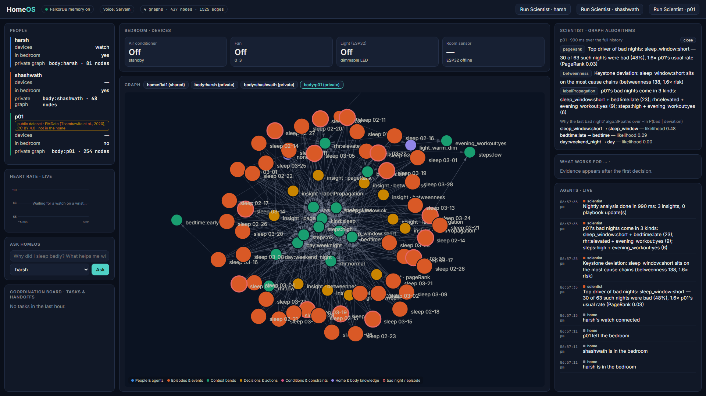
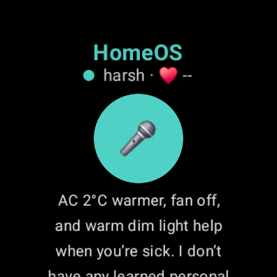
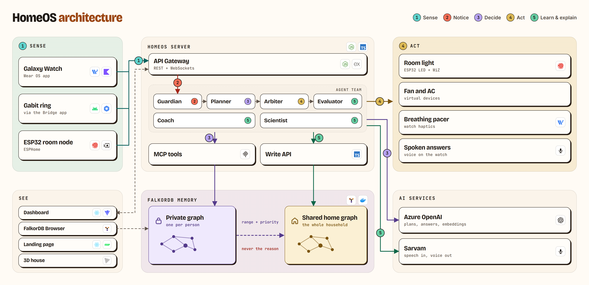
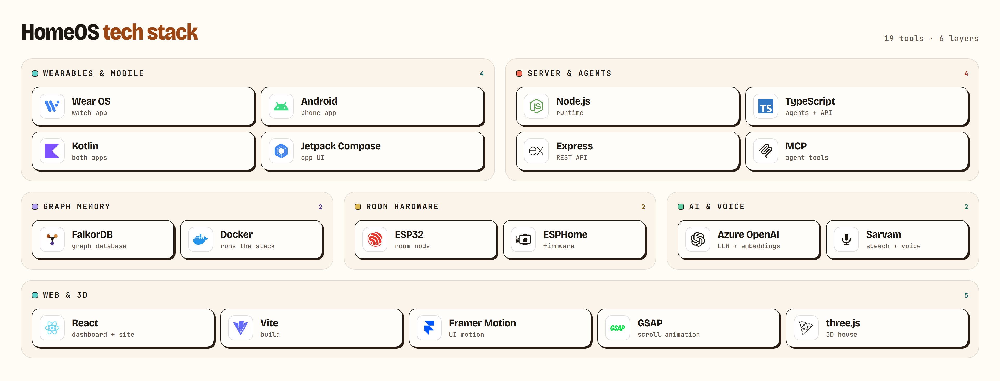
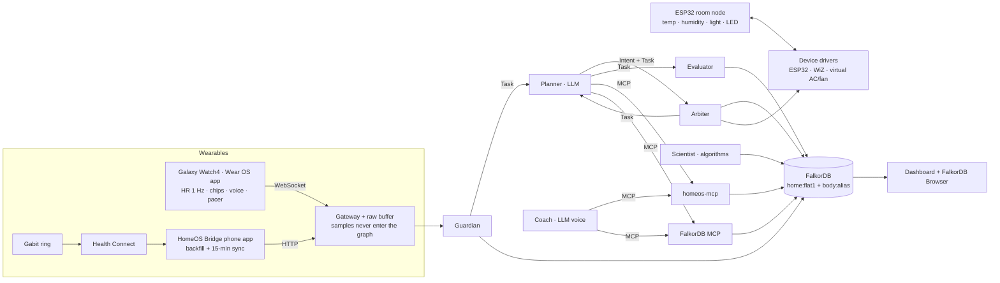
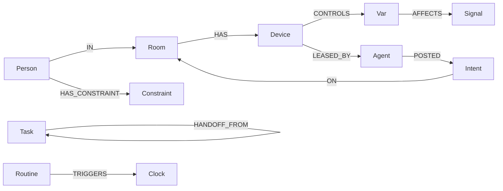
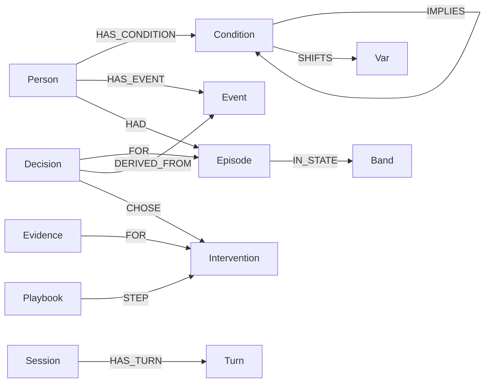
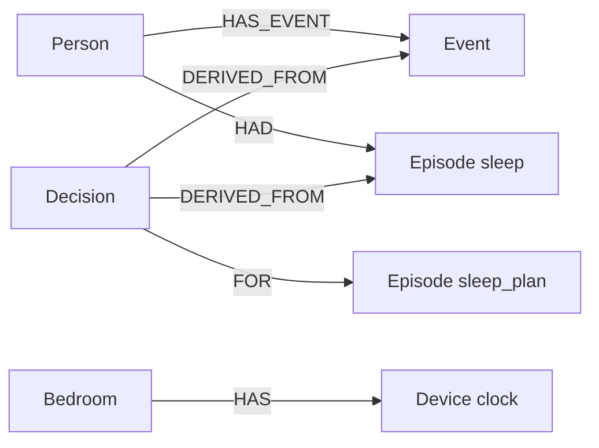

# HomeOS: a home with a nervous system

[**Live site**](https://main.d11a55m87k52ya.amplifyapp.com/) · [**Demo video**](https://www.youtube.com/watch?v=Et2mwpHbiZY)

Graph Hacks 2026, WeMakeDevs × FalkorDB. Track 1 and Track 2.

Your ring already knows you slept badly. Your calendar already knows you have an 8am. Your house knows neither, so it sits there. HomeOS puts both facts in FalkorDB and lets agents walk the edges. The action, and the explanation, come back as a path.

Each person has a private graph. The home has one shared graph that receives a temperature range and a priority, never the reason. Ask the watch why, and the answer is that path. Take FalkorDB out and the same scene cannot explain itself. That comparison is in [the ablation](#proof-the-graph-is-load-bearing-ablation).

Dashboard `http://localhost:3001` · FalkorDB Browser `http://localhost:3000` · [Setup, debug, and run](docs/SETUP.md) · [Track 1](docs/TRACK1.md) · [Track 2](docs/TRACK2.md) · [Who did what](#who-did-what) · [License](LICENSE)

The model never writes Cypher. People wrote the queries in [`graph/queries/`](graph/queries). The model picks a tool, over MCP, and fills parameters that are checked before anything runs. Writes go through one typed API. An empty traversal is said out loud as an empty traversal.

<p align="center">
  
  
</p>

```
"I'm feeling sick" (watch)  ─▶  private Condition{sick} in body:shashwath
                              ─▶ fever ⇒ sick ⇒ SHIFTS room_temp ≥ 26 °C, airflow ≤ 1   (multi-hop, graph data)
                              ─▶ only "room_temp 26–27, priority 3" is shared into home:flat1   (no reason, ever)
Harsh finishes a workout      ─▶ his planner wants the AC colder; the arbiter's multi-hop query says 26 °C is the floor
                              ─▶ fan to level 1 + a 5.5 breaths/min haptic pacer on his watch instead
"Why isn't it colder?"        ─▶ explain(): "someone present needs it ≥ 26 °C" — who and why stay private
3 minutes later               ─▶ the evaluator measures his HR recovery and updates Evidence with an atomic Welford UDF
Restart everything            ─▶ "what helps me when I'm sick?" — answered from the playbook, episodes and past turns
```

---

## Tracks

Every row points to the code and the Cypher that does the work. Full write-ups: [`docs/TRACK1.md`](docs/TRACK1.md), [`docs/TRACK2.md`](docs/TRACK2.md).

### Track 1: Agents That Act on Connected Data

| Official focus | What HomeOS does | Where (code · Cypher) |
|---|---|---|
| **Multi-hop reasoning** | Arbitration walks Room → Device -CONTROLS→ Var -AFFECTS→ Signal, and Room ←IN- Person -HAS_CONSTRAINT→ Constraint, then resolves conflicting ranges by priority (`HomeOS.resolveRanges` UDF). A person's needs come from Person → Condition -IMPLIES*0..3→ Condition -SHIFTS→ Var. | [`feasible_settings.cypher`](graph/queries/feasible_settings.cypher) · [`effective_comfort.cypher`](graph/queries/effective_comfort.cypher) · [`agents/arbiter.ts`](backend/src/agents/arbiter.ts) |
| **Graph queries & algorithms as agent tools** | 40 typed tools over MCP. They include `why_bad_night` (**algo.SPpaths** over −ln p weights), `drivers` (**algo.pageRank**), `keystone` (**algo.betweenness**), `episode_types` (**algo.labelPropagation**), `impact` (**algo.bfs**), `similar_episodes` (vector index), plus calendar, sleep-week, routine, scene, policy, and clock reads. On 150 real nights the full analysis takes 64 ms ([results](#real-data-results-the-scientist)). | [`tools/index.ts`](backend/src/tools/index.ts) · [`why_bad_night.cypher`](graph/queries/why_bad_night.cypher) · [`drivers.cypher`](graph/queries/drivers.cypher) |
| **Tool selection through MCP** | Each person's agents attach to **homeos-mcp** (our server, scoped to that person's ACL user) and the **official FalkorDB MCP server** (read-only, `home_reader` user). Azure OpenAI chooses among both sets of tools. | [`mcp/server.ts`](backend/src/mcp/server.ts) · [`llm/agent.ts`](backend/src/llm/agent.ts) |
| **Actions based on graph results** | AC, fan, light and the watch's breathing pacer are driven only by `choose_intervention` (Evidence + Thompson-sampling UDF) clamped by `feasible_settings`, then applied under an atomic device lease. | [`choose_intervention.cypher`](graph/queries/choose_intervention.cypher) · [`agents/planner.ts`](backend/src/agents/planner.ts) · [`acquire_device.cypher`](graph/queries/acquire_device.cypher) |
| **Explainable results** | Every Decision stores its provenance: context bands, chosen and rejected options with reasons, evidence used (n, mean) and the constraints that bounded it. `explain` walks it. The owner sees their private reasons; everyone else sees "someone present". | [`explain.cypher`](graph/queries/explain.cypher) · [`explain_arbitration.cypher`](graph/queries/explain_arbitration.cypher) · [`explain_paths.cypher`](graph/queries/explain_paths.cypher) |

### Track 2: Agent Memory and Coordination

| Official focus | What HomeOS does | Where |
|---|---|---|
| **Episodic memory** | Episodes (live and every ring night) → Decisions → Actions → OUTCOME edges with measured effects | [`create_episode.cypher`](graph/queries/create_episode.cypher) · [`learn.cypher`](graph/queries/learn.cypher) |
| **Semantic memory** | Baselines, conditions, preferences and dislikes as **bi-temporal** edges (`valid_from`/`valid_to`, never overwritten); device→variable→body priors with source URLs | [`set_baseline.cypher`](graph/queries/set_baseline.cypher) · [`belief_diff.cypher`](graph/queries/belief_diff.cypher) · [`seed/catalog.json`](graph/seed/catalog.json) |
| **Procedural memory** | Versioned Playbooks (`SUPERSEDES` chain), rewritten by the Scientist when a person's own outcomes disagree | [`publish_playbook.cypher`](graph/queries/publish_playbook.cypher) · [`agents/scientist.ts`](backend/src/agents/scientist.ts) |
| **Persistent conversation history** | Session -HAS_TURN→ Turn -ABOUT→ episode / decision / condition, with **vector + full-text** recall that survives restarts | [`add_turn.cypher`](graph/queries/add_turn.cypher) · [`recall_turns.cypher`](graph/queries/recall_turns.cypher) |
| **Shared state & handoffs** | Agents talk **only through the graph**: Task nodes with atomic claims and `HANDOFF_FROM` edges (Guardian → Planner → Arbiter → Planner → Evaluator); Intents; leases; a stalled agent's task is reclaimed | [`claim_task.cypher`](graph/queries/claim_task.cypher) · [`agents/worker.ts`](backend/src/agents/worker.ts) |
| **High-concurrency reads & writes** | Measured: 140 mixed operations at **~1,090 ops/s**. 40 concurrent Welford updates to the same Evidence nodes all landed (n +40, no lost updates), 30 workers each claimed one of 20 tasks exactly once, and 1 of 30 lease contenders won | [`test/memory.test.ts`](backend/test/memory.test.ts) · [`docs/results/concurrency.json`](docs/results/concurrency.json) |
| **Separate memory per user/tenant** | One graph per person (`body:<alias>`) and a shared `home:flat1`. Isolation is enforced **by FalkorDB ACL**: `agent_bob` gets `NOPERM` on `body:alice`, and agents can only `GRAPH.RO_QUERY` the home graph | [`graph/setup.ts`](backend/src/graph/setup.ts) · [`test/core.test.ts`](backend/test/core.test.ts) |

### Proof the graph is load-bearing: ablation

The same two-person scenario was run with `HOMEOS_GRAPH=on` and with FalkorDB removed (`HOMEOS_GRAPH=off`, fixed rules). Source: [`docs/results/ablation.md`](docs/results/ablation.md), generated by [`scripts/ablation.ts`](backend/scripts/ablation.ts).

| Step | FalkorDB on | FalkorDB off |
|---|---|---|
| Alice: "I'm sick" | AC 27 °C, fan off; within her own sick-day range | AC 27 °C |
| Bob finishes a workout | AC **stays 27 °C** (Alice's floor wins by priority); Bob gets the fan at level 1 plus a 5.5/min pacer | AC dropped to **22 °C** on a sick person |
| Bob: "why not colder?" | "someone present bounds it… your post-workout range had to stay within the shared limit" | "I don't have any memory…" |
| Alice: "what helps me when I'm sick?" | warmer AC, fan off, warm dim light, from her evidence and playbook | "I don't have any memory…" |

---

## Real-data results: the Scientist

The team's ring had almost no history before the event: the Gabit → Health Connect → HomeOS Bridge pipeline is verified end to end, but there was little to sync. So HomeOS also loads one participant of the public **PMData** dataset (Fitbit Versa 2, Nov 2019 – Mar 2020, CC BY 4.0, [attribution](replay/datasets/README.md)) as a separate, clearly labelled household member `p01` who is never in the home. Nothing is synthesised: 150 real nights, 137 rated by the participant (38 rated bad).

The Scientist works on *deviations from the person's own normal*: bands such as `sleep_window:short` or `rhr:elevated` carry the `:Notable` label, and everyday context does not. Output on p01 ([`docs/results/scientist_p01.json`](docs/results/scientist_p01.json), 64 ms):

| Algorithm | Finding |
|---|---|
| `algo.pageRank` over deviations co-occurring on bad nights | **Top driver: short sleep window.** 30 of 63 such nights were rated bad (48%), 1.6× p01's usual rate |
| `algo.betweenness` on episode → deviation → lever | Keystone deviation: short sleep window (most cause chains run through it) |
| `algo.labelPropagation` over bad nights + deviations | Bad nights come in **3 kinds**: short window + late bedtime (23) · elevated resting HR + evening workout (9) · very active day + evening workout (6) |
| `algo.SPpaths` over −ln P(bad \| deviation) | Last bad night: short sleep window (likelihood 0.48), then late bedtime (0.29) |

Asked "What usually ruins my nights?", the Coach chose `drivers`, `keystone` and `what_works` through MCP and answered: *"Mostly short sleep windows, evening workouts, and elevated resting heart rate."*

### Latency (graph work per decision)

Each query ran 30 times through the agents' own client and ACL users, against FalkorDB in Docker on a laptop ([`scripts/bench.ts`](backend/scripts/bench.ts), [`docs/results/latency.json`](docs/results/latency.json)). The p01 graph has 254 nodes and 1326 edges.

| Query | p50 | p95 |
|---|---|---|
| `effective_comfort (multi-hop, harsh)` | 6.2 ms | 13.8 ms |
| `feasible_settings (multi-hop, home)` | 6.0 ms | 7.2 ms |
| `impact (algo.bfs, home)` | 4.0 ms | 4.8 ms |
| `choose_intervention (Thompson UDF, p01)` | 6.5 ms | 7.7 ms |
| `why_bad_night (algo.SPpaths, p01)` | 4.1 ms | 5.9 ms |
| `drivers (algo.pageRank, p01)` | 3.6 ms | 5.0 ms |
| `keystone (algo.betweenness, p01)` | 5.6 ms | 24.2 ms |
| `similar_episodes (vector + bands, p01)` | 6.8 ms | 8.3 ms |

The graph is never the bottleneck. A full voice round trip (Sarvam STT → Coach choosing graph tools over MCP → Sarvam TTS on the watch) takes about 6–9 s, almost all of it LLM and speech.

---

## How it works

<picture>
  <source media="(prefers-color-scheme: dark)" srcset="docs/img/architecture-dark.png" />
  
</picture>

**Tech stack**

<picture>
  <source media="(prefers-color-scheme: dark)" srcset="docs/img/tech-stack-dark.png" />
  
</picture>

Both images are generated from [`docs/architecture/`](docs/architecture). The detailed flow:



| Agent | Kind | Reads | Writes (through the typed write API only) |
|---|---|---|---|
| **Guardian** (per person) | deterministic | live HR/IBI vs the person's own baseline, watch/phone chips, ring data | Conditions, Episodes + context Bands, `plan` tasks; asks before assuming |
| **Planner** (per person) | Azure OpenAI + graph tools via MCP | Evidence, feasible ranges, playbooks, similar episodes | Intents, `arbitrate` task, then Decision + Actions + `evaluate` task |
| **Arbiter** (home) | deterministic | home graph only (it cannot read anyone's private graph) | device leases, Arbitration nodes, device state, `record` task |
| **Evaluator** | deterministic | raw buffer after the action window, feedback | OUTCOME edges, Evidence via the `HomeOS.welford` UDF (one atomic query) |
| **Coach** (per person) | Azure OpenAI voice agent via MCP | everything in that person's graph + read-only home graph | Session/Turn memory; conditions, preferences and dislikes taught by voice |
| **Scientist** | batch | full history | band likelihoods, CO_OCCURS edges, Insights, new Playbook versions |

### The graph model

HomeOS keeps three kinds of graph. They are separate FalkorDB graphs, not three drawings of one database. A query on `body:harsh` cannot see `body:shashwath`. The home graph cannot see why a constraint exists.

**1. `home:flat1` — the shared house.** This is the only graph every agent can read. It holds rooms, devices, and what each device changes. People show up here only as presence plus an anonymous comfort range (`min`, `max`, `priority`). Agents hand work to each other as Task nodes. Nobody's illness, sleep, or calendar is stored here.



**2. `body:<alias>` — one private memory per person.** Harsh and Shashwath each get their own graph, enforced by a FalkorDB ACL user. Conditions, baselines, the ring's nights, the calendar, and the reason behind a decision stay here. `fever IMPLIES sick SHIFTS room_temp` is data in this graph, so the rule composes instead of living in an if-statement.



**3. The morning path — how the two graphs meet.** The watch asks a question that no single record answers: there is an early meeting, and the last week of sleep was bad, so should the clock move? The traversal stays in the private graph until the person says yes. Only then does a number land on the shared clock. The reason (which nights, which event) never leaves `body:<alias>`.



`Person`, `Event`, and `Episode` are in `body:<alias>`. `Decision -DERIVED_FROM-> Event` and `Decision -DERIVED_FROM-> Episode` are the path `explain` walks. `Clock` is a `Device` on `home:flat1`, reached by `Room -HAS-> Device`. The alarm times are properties on that device, written only after a yes.

### What the graph does that a lookup cannot

This is the bar from the hackathon guide: the graph has to shape the decision, and the path has to come back with the answer.

| The guide asks for | Where HomeOS does it |
|---|---|
| Follow connections across data | `IMPLIES*0..3` then `SHIFTS`, in [`effective_comfort.cypher`](graph/queries/effective_comfort.cypher). Room → Device → Var joined with Person → Constraint, in [`feasible_settings.cypher`](graph/queries/feasible_settings.cypher). Calendar event joined with the last seven sleep episodes, in [`morning_case.cypher`](graph/queries/morning_case.cypher). |
| Graph algorithms as tools | `algo.SPpaths`, `algo.pageRank`, `algo.betweenness`, `algo.labelPropagation`, `algo.bfs`. The model calls them by tool name. |
| The model must not write Cypher | 40 typed tools in [`backend/src/tools/index.ts`](backend/src/tools/index.ts), plus the official FalkorDB MCP server for read-only home queries. Arguments are parsed. Names that are not in the graph do not get a guessed answer. |
| Actions from graph results | Planner posts an Intent. Arbiter leases the device and applies a setpoint clamped by the query. Morning confirmation writes the clock only after `record_morning_decision.cypher`. |
| Show the path | [`explain.cypher`](graph/queries/explain.cypher) returns the decision, the episode, the evidence, and the constraints. The dashboard draws [`explain_paths.cypher`](graph/queries/explain_paths.cypher). |
| Remember across sessions | Episodes, bi-temporal beliefs, playbook versions, and `Session -HAS_TURN-> Turn`. They survive a FalkorDB restart. |
| Share state between agents | Task nodes and `HANDOFF_FROM`. No in-process message bus. |
| Separate memory per person | One graph per person, enforced by Redis ACL. `agent_bob` on `body:alice` gets `NOPERM`. |
| Say when it is not in the graph | No early calendar event, or no synced nights, is spoken as that. The agent does not invent an alarm. |

### FalkorDB features in use

| Feature | Used for |
|---|---|
| Multiple graphs + **Redis ACL** (`~body:alice`, `+GRAPH.RO_QUERY`) | one private graph per person, enforced by the database; read-only shared home |
| **JavaScript UDFs** (`GRAPH.UDF LOAD`): `welford`, `thompson`, `resolveRanges`, `intersectRanges`, `zscore`, `likelihood` | learning, exploration and conflict resolution inside queries ([`graph/udf/homeos.js`](graph/udf/homeos.js)) |
| **algo.SPpaths, algo.pageRank, algo.betweenness, algo.labelPropagation, algo.bfs** | cause chains, drivers, keystones, episode types, impact |
| **Vector indexes** (`Episode.embedding`, `Turn.embedding`, 1536-d cosine) + `db.idx.vector.queryNodes` | similar situations, semantic recall |
| **Full-text indexes** (`Turn.text`, `Episode.summary`) | keyword recall over conversations |
| **Unique constraints** (`GRAPH.CONSTRAINT`) + range indexes | integrity of people, devices, episodes, bands |
| Variable-length paths (`IMPLIES*0..3`, provenance `*1..4`) | condition inheritance, explanations |
| **Atomic single-query writes**, serialized per graph | race-free leases, task claims, evidence updates |
| `GRAPH.RO_QUERY` + per-query `TIMEOUT` | safe agent reads |
| **Official FalkorDB MCP server** | LLM ad-hoc read-only Cypher over the home graph |
| FalkorDB Browser | live inspection in the demo |

Every query the agents run lives in [`graph/queries/`](graph/queries) as a `.cypher` file. The function name is the filename. Each file starts with a comment naming the graph it runs on.

---

## Run it

Full setup, debug, and hardware steps: [docs/SETUP.md](docs/SETUP.md). Short version:

**Requirements:** Docker, Node 20+, Azure OpenAI (`gpt-5.4-mini` and `text-embedding-3-small` on a v1 endpoint). Sarvam is optional. This stack stays on the laptop because the watch, the ring, and the room node are on a private LAN. The steps below are the deployment.

```bash
cp .env.example .env              # Azure key, optional Sarvam, HOMEOS_GRAPH=on
docker compose up -d --build      # FalkorDB + Browser :3000, agents and dashboard :3001
curl http://127.0.0.1:3001/api/ping
curl http://127.0.0.1:3001/api/stats
```

`stats` is the live node and edge count of every graph. Open FalkorDB Browser at `http://localhost:3000` and run `GRAPH.LIST`.

Development, tests, and the graph-off comparison:

```bash
docker compose up -d falkordb
cd backend && npm ci && npm run dev        # API on :3001
cd ui && npm ci && npm run dev             # dashboard on :5173, proxied to :3001
cd backend && npm test                     # integration tests against live FalkorDB
cd backend && npx tsx scripts/ablation.ts  # same scene, graph on vs off
```

Calendar events are written with `POST /api/calendar/:alias` (`upsert_calendar_event.cypher`). Nights arrive from the phone's Health Connect sync. The watch chip **Morning alarm** runs `morning_case.cypher` and speaks the rows. A yes writes the decision and the bedroom clock. Without the ring, `cd backend && npx tsx scripts/morning-e2e.ts harsh` loads nights and one event through those same write functions, then runs the query. The script is a loader. The decision is the Cypher.

Public dataset and a recorded session:

```bash
cd backend && npx tsx scripts/import-pmdata.ts --batch ../replay/datasets/pmdata-p01.json --alias p01
cd backend && npx tsx scripts/replay.ts ../replay/recordings/<file>.jsonl --speed 2
```

Connect any MCP client (Claude Desktop, Cursor, …) to a person's memory:

```json
{ "mcpServers": { "homeos-harsh": { "command": "npx", "args": ["tsx", "backend/src/mcp/server.ts"], "env": { "HOMEOS_ALIAS": "harsh" } } } }
```

### Hardware

| Device | App | Notes |
|---|---|---|
| Samsung Galaxy Watch4 (SM-R865F, Wear OS 5) | [`apps/watch`](apps/watch) (Kotlin, Compose for Wear OS) | HR via Health Services; IBI/HRV via the Samsung Health Sensor SDK when its AAR is present; chips; push-to-talk with **Sarvam** speech-to-text (`saaras:v3`, code-mixed Hindi/English) and spoken replies (`bulbul:v3`), about 6–9 s from question to voice; haptic breathing pacer. Set `homeos.ws` and `homeos.alias` in `apps/watch/local.properties`, then `./gradlew installDebug` |
| Gabit smart ring | [`apps/phone`](apps/phone) "HomeOS Bridge" (Kotlin, Health Connect) | Gabit holds Health Connect write permission for HR, HRV, resting HR, sleep, steps, exercise and VO2max (verified on the phone). The app backfills 120 days, syncs every 15 minutes in the background, reports per-type read errors, and can be triggered from a laptop: `adb shell am broadcast -n com.homeos.bridge/.SyncReceiver --el days 120` |
| ESP32 room node | [`esphome/room-node.yaml`](esphome/room-node.yaml) | DHT11 temperature/humidity, light sensor, dimmable LED as the room light (`ESP32_HOST`) |
| Philips WiZ bulb | — | local UDP (`WIZ_HOST`) |
| AC, fan, and Google Clock | — | virtual devices on the dashboard behind the same driver interface. The clock's alarms are graph state (`alarm_primary`, `alarm_backup`), written only after the morning query and a yes |

---

## Privacy and safety

- Raw samples (1 Hz HR, IBI) stay in memory; the graph stores only what agents reason over.
- Health conditions live only in the person's own graph. The home graph gets an anonymous range and priority, and a database ACL stops other people's agents from reading private graphs.
- The LLM never writes Cypher. Every write goes through typed functions ([`writeapi/index.ts`](backend/src/writeapi/index.ts)); agent reads are read-only with timeouts.
- Device setpoints are clamped to device limits. The "do nothing" control arm is never used in live care. Outcomes are only learned from measured signals or explicit feedback, never invented.
- HomeOS is a wellness tool, not a medical device.

## What was built during the event, and what was reused

All FalkorDB work was written during Graph Hacks (Oct 15–18, 2026): the schema, the queries, the UDFs, the agents, the MCP server, the tests and the dashboard. Device plumbing reused from earlier team work, and disclosed here:

- **Wear OS client patterns** from the team's earlier project Rakshak (`NaomiiAP/codexhack`): WebSocket reconnect, `AudioBridge` (microphone → WAV, TTS playback), Health Services heart rate, Samsung SDK reflection.
- **Sarvam client** (`saaras:v3` / `bulbul:v3`) ported from the same project.
- The **ESP32 room node** and our notes on the Gabit ring's BLE protocol (from before the event). No decompiled vendor code is in this repo.

## Who did what

| | |
|---|---|
| **Shashwath** | ESP32 and the rest of the room hardware, temperature sensing, and getting the backend standing. |
| **Harshendra** | The Gabit ring connection and the phone app (HomeOS Bridge, Health Connect sync). |
| **Naomi** | The Galaxy Watch app, and the walkable 3D house. |
| **All three** | The main website. |

## Repository map

```
graph/          seeds, Cypher the agents actually run, UDF library, device and condition catalog
backend/        agents, the only write API, MCP server, ingest, drivers, voice, tests
ui/             dashboard: live graphs, decisions, provenance, evidence
apps/watch/     Wear OS          apps/phone/   Health Connect bridge
replay/         recorded sessions and PMData p01
docs/           TRACK1.md, TRACK2.md, SETUP.md, measured results
```

License: [MIT](LICENSE), Naomi, Harshendra, and Shashwath. How to change the graph without breaking isolation: [CONTRIBUTING.md](CONTRIBUTING.md).
